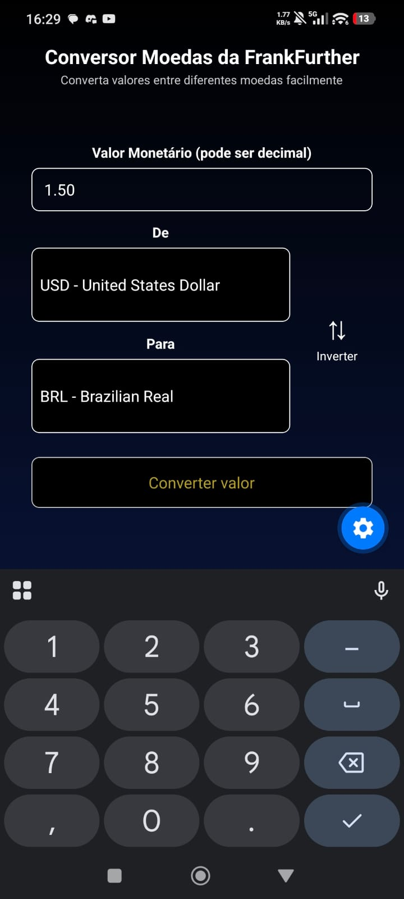
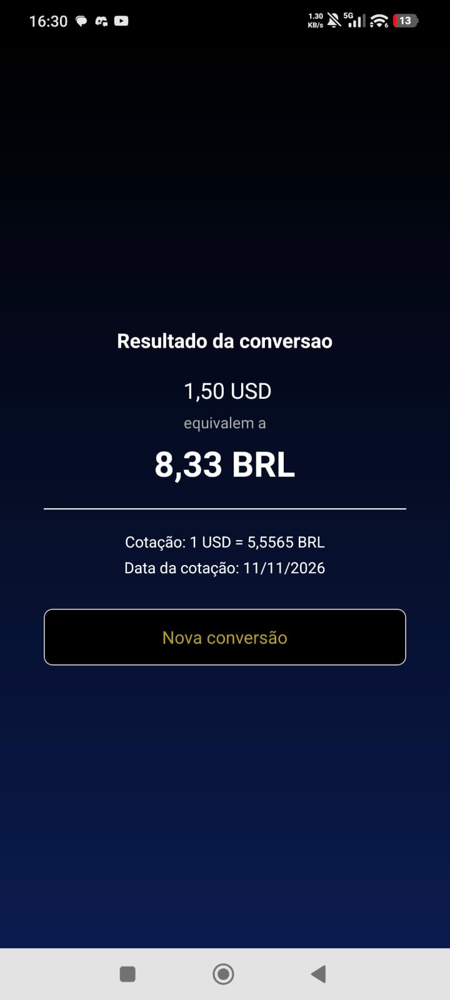
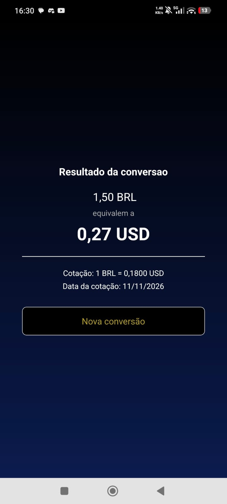
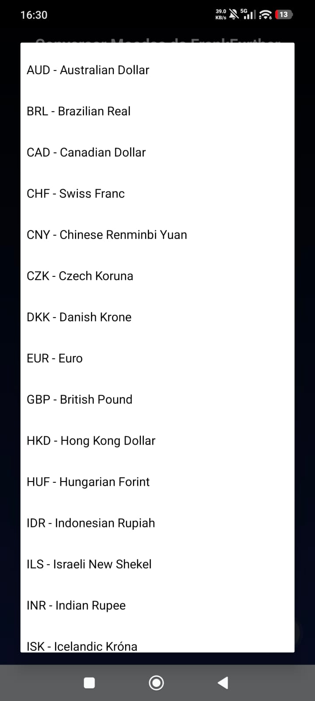
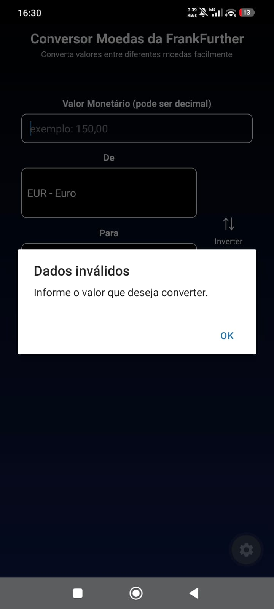
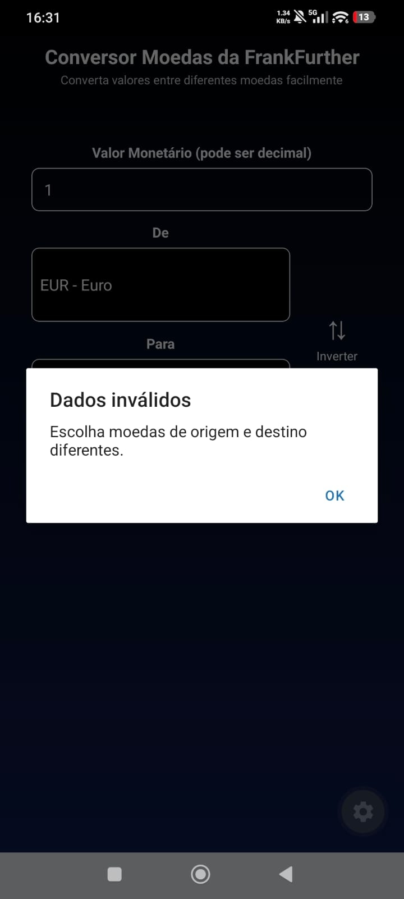
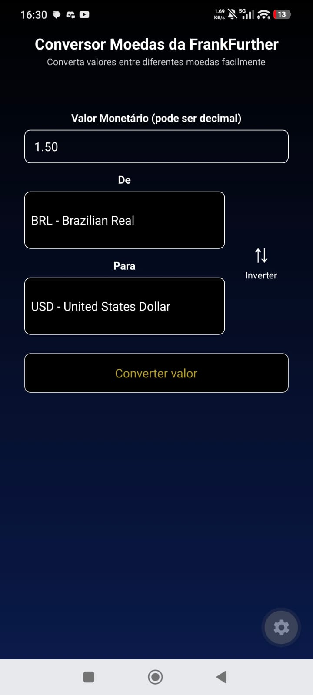

# Nome: Lucas Lemos Veneziani


# Aplicativo de Conversão de Moedas EXPO GO (Use expo go versão 57)

# Para utilizar precisa de Node.js, NPM e NPX

# Instalação:
# clone o repositorio e faça

```bash
git clone https://github.com/LucasVeneziani/ConversaoMoedas.git

# E depois instale

npm install

# Apos isso você pode fazer um

npx expo start

```


Imagens do programa no celular










